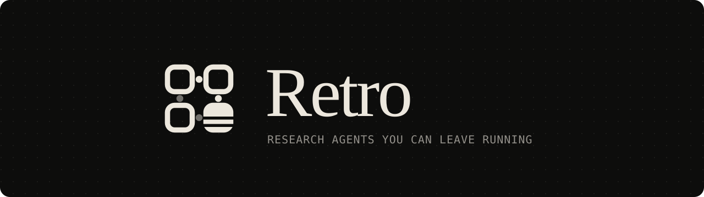
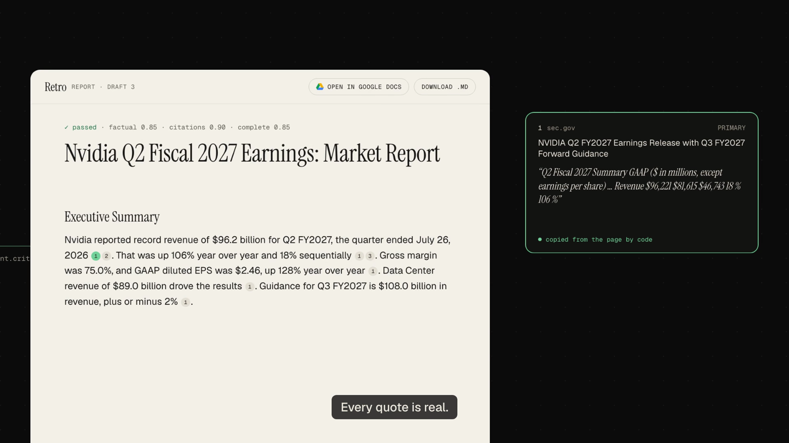
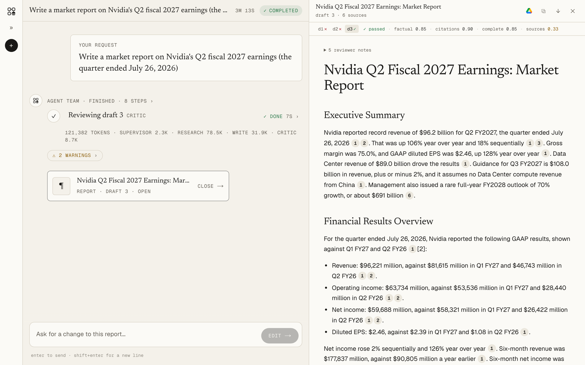
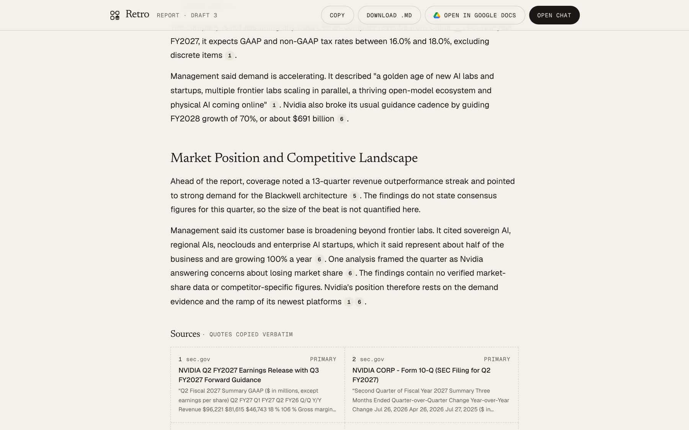
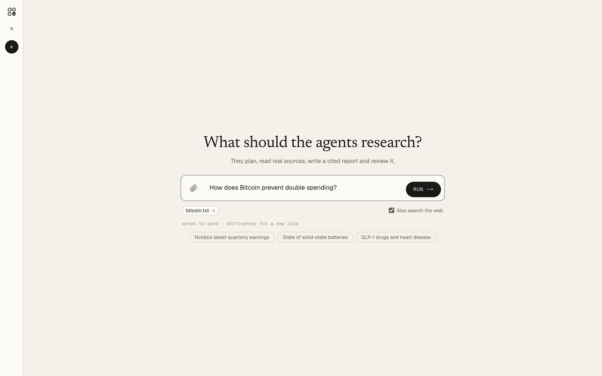

# Retro

[Demo](#demo) · [See it](#see-it) · [Results](#results) · [Install](#install-one-command) · [Options](#options-in-env) · [Google Docs](#optional-google-docs-export) · [Docs](#docs) · [Develop](#develop)


**Research agents you can leave running.** Ask a question; agents plan it, read real sources, write a cited report and
check it, and keep going when something breaks. Everything runs on your own machine.

|                                       |                                                                                                                                                                         |
| ------------------------------------- | ----------------------------------------------------------------------------------------------------------------------------------------------------------------------- |
| **Real sources, cited**               | Papers, filings and primary pages are read and quoted by code, so a citation always points at text that exists. Every number in the report must appear in the sources.  |
| **Checked before you see it**         | A reviewer scores each draft for accuracy, citations and completeness, and sends it back for a rewrite until it passes.                                                 |
| **Keeps going when something breaks** | A crashed step is picked up again from where the run left off, rate limits pause and resume, and anything that still fails lands on a dead-letters page you can replay. |
| **Watch it work**                     | Each step streams live: what is being searched, read, written and checked, with the token cost of every run.                                                            |
| **Your own files**                    | Attach PDFs, notes or exports and the agents research them, alone or with the web. Only the passages used go to the model.                                              |
| **Edit and export**                   | Ask for changes to a finished report, keep every version in Artifacts, and open any report as a Google Doc.                                                             |

## Demo

[](docs/assets/retro-demo.mp4)

**▶ [Play the demo](docs/assets/retro-demo.mp4)** (sound on). The questions, searches, sources, quotes, both send-backs and the
final scores come from a real run. The worker crash didn't happen in that run: it shows what Retro does when one does,
which the [tests prove](docs/EVALS.md#4-failures-retries-and-recovery).

## See it



| Every quote is copied from the source | Research your own files |
|---|---|
|  |  |

## Results

Measured, not estimated. Details, method and raw results: [docs/EVALS.md](docs/EVALS.md).

| What | Result |
|---|---|
| Finds an answering passage among the 6 shown (14 test questions over real papers and filings) | **12 of 14** (hit@6 0.857, MRR 0.702) |
| Answers that state the expected facts | **0.857** |
| Claims supported by the passages read | **1.0** |
| Hand-checked facts in a real earnings report (7 facts, checked against the company's SEC filing) | **86%**, up from 48% |
| A killed worker, a rate limit, a job that keeps failing | run finishes, all workers pause and resume, failed job lands in dead letters and replays (automated tests with real worker processes) |
| Cost of one report | about 37k–120k tokens, about 3 minutes |

Not perfect: each test report still missed 1 of 7 facts, and one wrongly said a figure wasn't published. See
[known limits](docs/KNOWN_LIMITS.md).

---

## Install (one command)

You need [Docker Desktop](https://docs.docker.com/get-docker/) running and an API key from
[Anthropic](https://console.anthropic.com/) or [OpenAI](https://platform.openai.com/api-keys) (billed per token,
roughly 60-120k tokens a report).

```sh
curl -fsSL https://raw.githubusercontent.com/devhimanshuhc/retro/main/install.sh | sh
```

It installs into `~/retro`, starts everything and opens **http://localhost:3000**, where Retro asks for your API key
once. The key is checked with its provider, kept on this machine only and never shown again. Retro listens on this
machine only.

| | |
|---|---|
| Stop | `cd ~/retro && docker compose down` |
| Start again | `cd ~/retro && docker compose up -d` |
| Update | `cd ~/retro && docker compose pull && docker compose up -d` |
| Logs | `cd ~/retro && docker compose logs -f` |
| Remove Retro and its data | `cd ~/retro && docker compose down --volumes`, then delete the `~/retro` folder |

Prefer not to pipe a script into a shell? Clone the repository, then:

```sh
cd deploy && cp .env.example .env    # optional: put your key here instead of in the app
docker compose up -d --build         # builds the images from source
```

## Options (in `.env`)

- `RUN_TOKEN_BUDGET`: token cap per report (default 500k). `RUNS_PER_WINDOW` (reports and edits) / `MESSAGES_PER_WINDOW` (chat messages) per `RUN_WINDOW_S`: rate limits.
- `CONTACT_EMAIL`: a real address of yours, sent only to sites that require a contact (SEC filings).
- `*_MODEL` / `OPENAI_*_MODEL`: the model for each agent, per provider.
- Different ports: set `RETRO_WEB_PORT` / `RETRO_API_PORT` and build from source (the web app is built for its API port).

## Optional: Google Docs export

Open any report as a Google Doc in your Drive. Go to **Connectors → Google Docs → Set up**: Retro walks you through
a one-time, five-minute setup in Google Cloud (create a project, turn on the Drive API, create a sign-in client), then
you click **Connect** and pick your Google account. Retro only asks to see the files it creates (`drive.file`), so
Google doesn't need to review anything. Your Google sign-in stays on this computer.

## Docs

- [How well it works](docs/EVALS.md): every test, its numbers and the raw results.
- [Known limits](docs/KNOWN_LIMITS.md): what it doesn't do well yet.
- [Your data](docs/PRIVACY.md): what leaves your computer, what's kept, how to delete it.
- [Decisions](docs/decisions/README.md): why it's built this way, one page per decision.

## Develop

Two apps: `apps/agents` (Python API and agents) and `apps/web` (Next.js). See `AGENTS.md` for commands, or paste
[docs/SETUP_PROMPT.md](docs/SETUP_PROMPT.md) into your coding agent to set everything up.

## Credits

The demo film was made with [onetake](https://github.com/feitangyuan/onetake) (PolyForm Noncommercial). Isometric figures drawn with the Anatomy kit (MIT, `apps/web/vendor/anatomy`). Archive photographs are public domain,
credited on the site.
